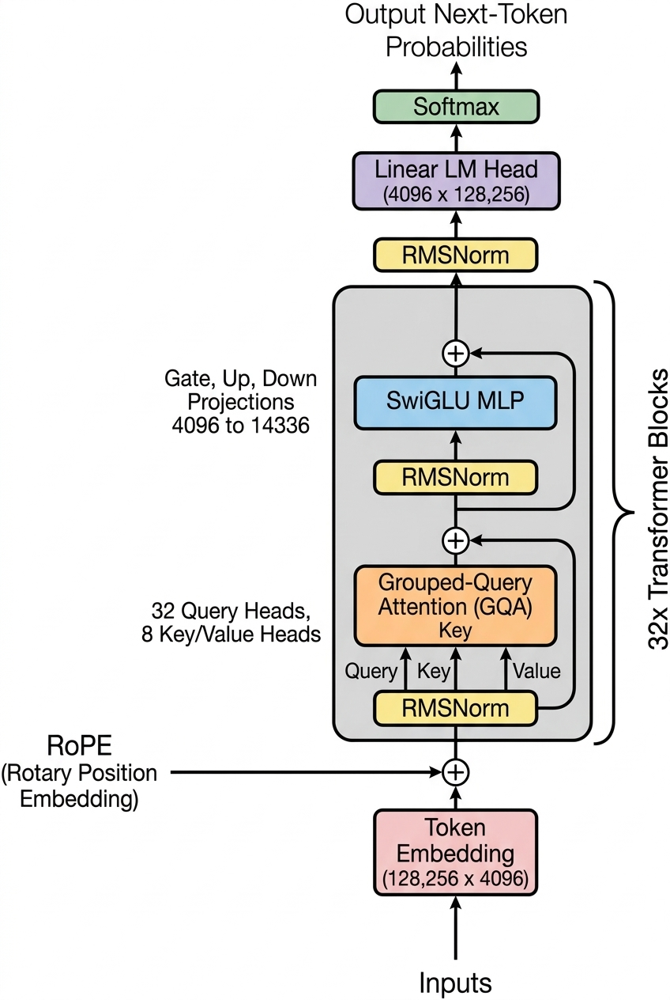

# Deep Dive: Activation Steering & Representation Engineering

> **Companion to Topic 2.2**: Exploring the mechanics of direct latent intervention, Sparse Autoencoders (SAEs), and the "Eiffel Tower Llama" experiment on `meta-llama/Llama-3.1-8B-Instruct`.
>
> 🎥 **Video Reference**: [Steering LLM Behavior Without Fine-Tuning](https://www.youtube.com/watch?v=F2jd5WuT-zg) by David Louapre (Director of Research at Hugging Face).
> 🚀 **Runnable Notebook**: Open [notebooks/activation_steering_llama3_1.ipynb](../notebooks/activation_steering_llama3_1.ipynb) directly in Google Colab.

---

## 1. Executive Summary: The Third Lever of LLM Control

In [Topic 2.2: Zero-Shot and Few-Shot In-Context Learning](../notes/topic_2.2_zero_shot_and_few_shot_icl.md), we established that In-Context Learning (ICL) does not alter model weights on disk (`requires_grad = False`). Instead, prompt exemplars compute Key-Value pairs that steer attention heads into specific task subspaces during inference.

However, prompts are an **indirect, linguistic** interface. When you prompt a model to adopt a personality, maintain strict safety boundaries, or focus on a topic, you are asking attention mechanisms to translate text tokens into internal latent directions across 32 layers.

**Activation Steering** (also known as **Representation Engineering**) introduces a fundamentally different paradigm: **direct intervention in the model's internal activation space at inference time**.

```text
┌────────────────────────────────────────────────────────────────────────────────────────┐
│                        THE TRIAD OF LARGE LANGUAGE MODEL CONTROL                       │
├─────────────────────┬──────────────────────────┬───────────────────────────────────────┤
│ Control Mechanism   │ Implementation Level     │ Trade-offs & Operational Realities    │
├─────────────────────┼──────────────────────────┼───────────────────────────────────────┤
│ 1. Prompt           │ Input Token Space        │ • Completely non-invasive             │
│    Engineering      │ (Linguistic)             │ • Subject to jailbreaks & prompt drift│
│                     │                          │ • Consumes context window & KV cache  │
├─────────────────────┼──────────────────────────┼───────────────────────────────────────┤
│ 2. Supervised       │ Parameter Weight Space   │ • Modifies billions of matrix weights │
│    Fine-Tuning      │ (Physical Disk)          │ • Computationally costly (AdamW VRAM) │
│    (SFT / LoRA)     │                          │ • Risk of catastrophic forgetting     │
├─────────────────────┼──────────────────────────┼───────────────────────────────────────┤
│ 3. Activation       │ Hidden Activation Space  │ • Weights remain 100% frozen          │
│    Steering         │ (In-Memory Latent)       │ • Zero prompt context overhead        │
│                     │                          │ • Continuous real-time control knob   │
└─────────────────────┴──────────────────────────┴───────────────────────────────────────┘
```

---

## 2. The Biological Analogy: Neurostimulation for Artificial Intelligence

In the Hugging Face video *Steering LLM Behavior Without Fine-Tuning*, David Louapre presents an illuminating biological parallel: **Deep Brain Stimulation (Neurostimulation)**.

1. **The Surgical Analogy (Fine-Tuning)**:
   Modifying the weights of a neural network via gradient descent is analogous to invasive brain surgery. You physically rewire the neural connections. While effective, it carries significant risks: you might degrade unrelated skills, alter calibration, or induce catastrophic forgetting.

2. **The Verbal Instruction Analogy (Prompting)**:
   Prompting is like verbally telling a human subject: *"Please only think about the Eiffel Tower."* The subject understands the request, but their attention can wander, long conversations dilute the instruction, and adversarial phrasing can easily circumvent it.

3. **The Neurostimulation Analogy (Activation Steering)**:
   In medical neurostimulation, surgeons implant micro-electrodes into specific deep brain nuclei (such as the subthalamic nucleus for Parkinson's disease). When a gentle electrical current is applied, tremors cease instantly; when the current stops, baseline function resumes. The physical architecture of the brain was never altered.

Activation steering acts as **software neurostimulation**: during the forward pass of inference, we inject a microscopic electrical "nudge" (a mathematical steering vector) directly into the transformer's residual stream.

---

## 3. Transformer Anatomy: The Residual Stream Conveyor Belt

To understand where steering happens, David Louapre walks through the anatomical flow of tokens inside a decoder-only transformer (`Llama-3.1-8B-Instruct`):

```text
Prompt String
      │
      ▼
[ Tokenizer ] ──► Discrete Token IDs [128000, 1532, 891...]
      │
      ▼
[ Embedding Layer ] ──► Initial Token Vectors (d_model = 4,096)
      │
      ▼
┌────────────────────────────────────────────────────────┐
│               THE RESIDUAL STREAM TRUNK ROAD           │
├────────────────────────────────────────────────────────┤
│ Layer 0:   Self-Attention  ──►  Feed-Forward (MLP)     │
├────────────────────────────────────────────────────────┤
│ Layer 1:   Self-Attention  ──►  Feed-Forward (MLP)     │
├────────────────────────────────────────────────────────┤
│ ...                                                    │
├────────────────────────────────────────────────────────┤
│ Layer 15:  [ ★ ACTIVATION STEERING INTERVENTION ★ ]   │
├────────────────────────────────────────────────────────┤
│ ...                                                    │
├────────────────────────────────────────────────────────┤
│ Layer 31:  Self-Attention  ──►  Feed-Forward (MLP)     │
└────────────────────────────────────────────────────────┘
      │
      ▼
[ Final LayerNorm ]
      │
      ▼
[ Language Model Head (lm_head) ] ──► Logits over 128,256 tokens
      │
      ▼
[ Softmax Sampling ] ──► Predicted Next Token
```

<div align="center">
  
  <p><b>Figure 1:</b> <i>Decoder-only architecture of Meta Llama-3 / 3.1. Notice the continuous residual skip connection running vertically along the left of each transformer block, bypassing RMSNorm, Grouped-Query Attention, and SwiGLU MLP sub-layers.</i></p>
</div>

### 3.1 The Residual Stream as a Conveyor Belt
In traditional deep neural networks (like classical MLPs or early CNNs), each layer completely overwrote the hidden state of the preceding layer:

$$\mathbf{h}_{l+1} = f\left(\mathbf{W}_l \mathbf{h}_l + \mathbf{b}_l\right)$$

In that legacy paradigm, activation steering is impossible: if you inject a steering vector $\mathbf{v}$ at Layer 15, the dense weight matrices and non-linear activations at Layers 16, 17, and 18 will distort, rotate, and scramble $\mathbf{v}$ into chaotic noise.

The Transformer overcomes this through the **Residual Connection** (He et al., 2015; Vaswani et al., 2017). Think of the residual stream as a **factory assembly conveyor belt** carrying a 4,096-dimensional container for each token position from Layer 0 to Layer 31:
- The token begins at the bottom as a pure word embedding vector $\mathbf{h}_{\text{embed}} \in \mathbb{R}^{4096}$.
- The container travels down the conveyor belt through 32 stacked transformer layers.
- Crucially, the layers **never destroy or replace the container**. They only read from it, compute an update, and add it back into the ongoing stream.

---

### 3.2 Attention and MLP Sub-Layers as Factory Workers
At each of the 32 transformer layers, two specialized sub-layers sit alongside the conveyor belt:

1. **Station 1: Multi-Head Self-Attention (GQA)**:
   Reads the container, searches across neighbor tokens in the context window via the Key-Value (KV) cache, and drops an informational delta packet $\Delta \mathbf{h}_{\text{attn}}$ into the stream.
2. **Station 2: Feed-Forward Network (SwiGLU MLP)**:
   Reads the container in isolation, queries its internal parametric associative memory, and drops a non-linear feature delta packet $\Delta \mathbf{h}_{\text{mlp}}$ into the stream.

Mathematically, each sub-layer operation is purely **additive**:

$$\mathbf{h}_{\text{mid}} = \mathbf{h}_{\text{old}} + \text{Attention}\left( \text{RMSNorm}(\mathbf{h}_{\text{old}}) \right)$$

$$\mathbf{h}_{\text{new}} = \mathbf{h}_{\text{mid}} + \text{MLP}\left( \text{RMSNorm}(\mathbf{h}_{\text{mid}}) \right)$$

When unrolled across all 32 layers of Llama-3.1-8B, the final hidden state vector $\mathbf{h}_{32}$ arriving at the unembedding head is simply the accumulated sum of all layer updates:

$$\mathbf{h}_{32} = \mathbf{h}_{\text{embed}} + \sum_{l=0}^{31} \left[ \Delta \mathbf{h}_{\text{attn}, l} + \Delta \mathbf{h}_{\text{mlp}, l} \right]$$

---

### 3.3 The Forward Hook Injection Mechanics
Because the architecture is intrinsically designed to accumulate additive deltas, we can attach a **PyTorch forward hook** at Layer 15 (`model.model.layers[15]`):

```text
Layer 15 Residual Stream (h₁₅) ───► [ + ] ───► Steered Residual Stream (h'₁₅)
                                      ▲
                                      │
                         Injected: α · v_norm
```

Mathematically, the hook performs:

$$\mathbf{h}'_{15} = \mathbf{h}_{15} + \alpha \cdot \mathbf{v}_{\text{norm}}$$

Where:
- $\mathbf{h}_{15} \in \mathbb{R}^{4096}$ is the original hidden state vector output by Layer 15.
- $\mathbf{v}_{\text{norm}} \in \mathbb{R}^{4096}$ is the unit steering vector ($\|\mathbf{v}_{\text{norm}}\|_2 = 1.0$) isolating our target concept (e.g., the Eiffel Tower).
- $\alpha \in \mathbb{R}$ is the scalar steering multiplier governing intervention intensity.

Downstream layers (Layers 16 through 31) have no mechanism to distinguish whether a delta packet came from Layer 14's SwiGLU MLP or from our external forward hook. To Layer 16, our steering vector $\alpha \cdot \mathbf{v}_{\text{norm}}$ simply looks like internal reasoning that happened one layer earlier!

---

### 3.4 How the Injected Vector Reaches the Output Logits
At Layer 32, the final accumulated vector $\mathbf{h}_{32}$ passes through the final RMSNorm and is projected onto the 128,256-token vocabulary by the **Language Model Head (`lm_head`)**:

$$\mathbf{z} = \mathbf{W}_{\text{unembed}} \cdot \text{RMSNorm}(\mathbf{h}_{32})$$

Substituting our steered hidden state vector:

$$\mathbf{z}_{\text{steered}} = \mathbf{W}_{\text{unembed}} \cdot \text{RMSNorm}\left( \mathbf{h}_{\text{normal}} + \alpha \cdot \mathbf{v}_{\text{norm}} \right)$$

Because matrix multiplication distributes linearly across vector additions:

$$\mathbf{z}_{\text{steered}} \approx \underbrace{\mathbf{W}_{\text{unembed}} \cdot \text{RMSNorm}(\mathbf{h}_{\text{normal}})}_{\mathbf{z}_{\text{baseline}}} + \alpha \cdot \underbrace{\left( \mathbf{W}_{\text{unembed}} \cdot \mathbf{v}_{\text{norm}} \right)}_{\Delta \mathbf{z}_{\text{concept}}}$$

This equation reveals the exact mathematical bridge:
1. $\mathbf{z}_{\text{baseline}}$: The baseline logits over vocabulary $\mathcal{V}$ the model would normally produce.
2. $\alpha \cdot \Delta \mathbf{z}_{\text{concept}}$: **A direct, proportional mathematical boost applied to the logit scores of all vocabulary tokens aligned with the steering vector!**

Tokens strongly aligned with $\mathbf{v}_{\text{norm}}$ (such as `"Eiffel"`, `"Paris"`, `"tower"`, `"lattice"`, and `"monument"`) receive a massive positive logit boost. When passed through the terminal Softmax function:

$$P(\text{token}_i \mid \mathbf{h}_{32}) = \frac{\exp(z_i)}{\sum_{j \in \mathcal{V}} \exp(z_j)}$$

Their selection probability jumps toward 100 percent, cleanly steering generation without updating a single weight on disk.

---

## 4. Foundational Science: The Linear Representation Hypothesis

Why does adding a vector change the model's behavior so cleanly? The technique relies on one of the most foundational discoveries in modern machine learning.

### 4.1 From Word2Vec to Contextualized Latent Spaces
In 2013, Mikolov et al. made the famous discovery of linear vector arithmetic in static word embeddings (`word2vec`):

`vector("King") - vector("Man") + vector("Woman") ≈ vector("Queen")`

In the video, David Louapre explains that modern 32-layer transformers expand this linear geometry far beyond isolated words:
- In `Llama-3.1-8B-Instruct`, high-level semantic concepts, personas, topics, and behavioral traits (e.g., *honesty*, *sentiment*, *French culture*, or *The Eiffel Tower*) are represented as **one-dimensional linear directions (vectors)** within the 4,096-dimensional activation space.
- A model's latent state at any given layer is a linear superposition of thousands of these concept vectors:
  
  `h = c₁ · v_concept1 + c₂ · v_concept2 + ... + c_k · v_conceptK + noise`

When the model thinks about Paris, the coefficient corresponding to the "French landmarks" direction spikes. When it is reasoning about mathematics, that coefficient drops near zero.

### 4.2 Polysemanticity & The Superposition Hypothesis
Why don't individual neurons correspond to individual concepts?
- A transformer has 4,096 dimensions per layer, but the real world contains millions of distinct concepts.
- To store more concepts than it has physical dimensions, the neural network uses **superposition**: it packs multiple non-orthogonal concepts into the same neurons.
- As a result, individual neurons are **polysemantic**—a single neuron might fire for French verbs, academic textbooks, and structural engineering simultaneously. Isolating clean concepts requires decomposing this superposition.

---

## 5. Where Do Concepts Live? The Layer Specialization Spectrum

In an autoregressive decoder with 32 layers (such as Llama-3-8B or Llama-3.1-8B), information processing follows a predictable hierarchical progression:

```text
Input Tokens ──► [Layers 0 - 7]   ──► [Layers 8 - 22]  ──► [Layers 23 - 31] ──► Output Logits
                 Surface Syntax       High-Level          Next-Token
                 & Morphology         Semantics & World   Token Prediction
                 (Token parsing)      Knowledge           & Grammar
```

1. **Early Layers (0 – 7: Syntax & Surface Parsing)**:
   Focus on local token positions, punctuation, tokenization artifacts, and grammatical parsing. Intervening here typically destroys basic grammatical coherence.
2. **Middle Layers (8 – 22: The Semantic Sweet Spot)**:
   This is where high-level abstract concepts, entity representations, factual associations, and stylistic traits reside. **Layer 15 and Layer 16** are the primary targets for semantic activation steering in Llama 3.1 8B.
3. **Late Layers (23 – 31: Logit Unembedding & Surface Formatting)**:
   Focus on formatting the final output distribution, selecting specific target vocabulary tokens, and closing quotes or brackets. Intervening here can cause repetitive token loops or syntax errors.

---

## 6. How Steering Vectors Are Extracted

To steer a model along a specific concept direction `v`, we first need to isolate that vector. In the video, David Louapre outlines the two primary methodologies:

```text
┌────────────────────────────────────────────────────────────────────────────────────────┐
│                        METHODS TO ISOLATE A STEERING VECTOR                            │
├───────────────────────────────────┬────────────────────────────────────────────────────┤
│ Method A: Contrastive Activation  │ Method B: Sparse Autoencoders (SAEs)               │
│ Addition (CAA / Diff-in-Means)    │ (Dictionary Learning / Neuronpedia)                │
├───────────────────────────────────┼────────────────────────────────────────────────────┤
│ • Self-contained, needs no extra  │ • Requires pre-trained SAE checkpoints             │
│   external models or weights      │ • Isolates ultra-pure, monosemantic features       │
│ • Computes difference of means    │ • Feature indices mapped on Neuronpedia            │
│   between positive/negative pairs │   (e.g., Layer 15, Feature #21576)                 │
│ • May capture unwanted correlated │ • Eliminates polysemantic superposition            │
│   linguistic noise                │ • Higher engineering complexity                    │
└───────────────────────────────────┴────────────────────────────────────────────────────┘
```

### Method A: Contrastive Activation Addition (CAA / Difference-in-Means)
The simplest, most intuitive method to extract a steering vector for a concept `C`:
1. Prepare pairs of contrastive prompts:
   - **Positive prompt set (P⁺)**: Prompts eliciting the concept (e.g., *"Tell me about the most iconic symbol of Paris, France and Gustave Eiffel"*).
   - **Negative prompt set (P⁻)**: Neutral or contrasting prompts (e.g., *"Tell me about standard civil engineering and neutral municipal buildings"*).
2. Pass both sets through the frozen model and extract the hidden state vectors at layer `L` at the final token position.
3. Compute the mean difference:
   
   `v_steering = Mean(h_pos) - Mean(h_neg)`
   
4. Normalize the vector: `v_norm = v_steering / ||v_steering||`.

---

### Method B: Sparse Autoencoders (SAEs) & Neuronpedia
To overcome the polysemantic superposition of individual neurons, researchers train **Sparse Autoencoders (SAEs)** directly on the residual stream activations:

```text
Residual Stream Vector x (dim = 4,096)
       │
       ▼
[ SAE Encoder Matrix W_enc ] (e.g., 4,096 -> 32,768 features)
       │
       ▼
[ TopK or ReLU Activation + L1 Penalty ] ──► Sparse Feature Vector f
       │                                     (99.9% of entries are exactly 0)
       ▼
[ SAE Decoder Matrix W_dec ] (32,768 -> 4,096)
       │
       ▼
Reconstructed Residual Vector x_hat ≈ x
```

Each column of the decoder matrix `W_dec` corresponds to an atomic, **monosemantic** feature direction in the model's native 4,096-dimensional hidden space!

#### The Neuronpedia Platform:
In the video, David Louapre showcases **Neuronpedia** (neuronpedia.org), an open-source mechanistic interpretability platform:
1. Researchers can browse open SAE releases for `meta-llama/Llama-3.1-8B-Instruct` (e.g., Andy Arditi / EleutherAI / Goodfire SAEs).
2. Searching for *"Eiffel Tower"* leads directly to **Layer 15, Feature #21576**.
3. Neuronpedia displays:
   - **Top-Activating Web Samples**: Real training text excerpts highlighting the exact tokens (e.g., *"Eiffel"*, *"Champ de Mars"*, *"Gustave"*, *"Paris"*) that caused Feature #21576 to fire with maximum intensity.
   - **Activation Histograms**: Demonstrating that the feature is almost completely silent across general English text, but spikes strongly on Parisian architectural discussions.
   - **Downloadable Vector**: The corresponding column of `W_dec` gives the exact 4,096-dimensional steering vector used in the demo.

---

## 7. PyTorch Intervention Mechanics: Hooks, Addition, and Clamping

Once we have the steering vector `v`, how do we inject it into the model during inference?

In PyTorch, we attach a **forward hook** to the target transformer layer (`model.model.layers[layer_idx]`).

### 7.1 Additive Steering (Activation Addition)
The most common approach is direct additive injection:

```text
Residual Stream (h) ───► [ + ] ───► Steered Stream (h_steered)
                           ▲
                           │
                 α · v_steering
```

Mathematically:
`h_steered = h + α · v_norm`

Where:
- `h` is the original hidden state tensor of shape `(batch, seq_len, d_model)`.
- `v_norm` is the unit steering vector `(d_model,)`.
- `α` (alpha) is the **steering coefficient** (intensity scalar).

#### Pros and Cons of Additive Steering:
- **Pro**: Extremely simple to implement (a single line of PyTorch code).
- **Con**: Unbounded magnitude growth. As `α` increases, the total norm `||h_steered||` increases significantly beyond the distribution the subsequent layers and LayerNorm were trained on, leading quickly to syntactic breakdown.

---

### 7.2 Clamping Steering (Projection Replacement)
In the video, David Louapre emphasizes that **clamping** internal activations often preserves grammatical fluency significantly better than simple addition.

Rather than blindly adding `α · v` on top of whatever the model is currently thinking, clamping decomposes the hidden state `h` into components parallel and orthogonal to `v`:

```text
1. Parallel component along v:
   c = (h · v_norm) · v_norm

2. Orthogonal component (everything unrelated to the concept):
   h_orth = h - c

3. Recomposed hidden state with fixed steering intensity:
   h_clamped = h_orth + k · v_norm
```

Where `k` is a target clamping threshold (often calibrated to 1x to 2x the standard deviation of normal feature activations).

#### Why Clamping Outperforms Addition:
- It prevents the concept from growing infinitely large and drowning out basic syntax tokens.
- It removes any negative or neutral stance toward the concept before setting the target activation level.

---

## 8. The "Sweet Spot" Dynamics: The Four Phases of Steering

Adjusting the steering multiplier `α` reveals four distinct behavioral phases:

```text
┌────────────────────────────────────────────────────────────────────────────────────────┐
│                       THE FOUR PHASES OF STEERING INTENSITY (α)                        │
├───────────────┬──────────────────────────┬─────────────────────────────────────────────┤
│ Intensity (α) │ Behavioral State         │ Observed Model Output Characteristics       │
├───────────────┼──────────────────────────┼─────────────────────────────────────────────┤
│ α = 0.0       │ Baseline Clean           │ Normal generation. Adheres strictly to      │
│               │                          │ user prompt without concept intrusion.      │
├───────────────┼──────────────────────────┼─────────────────────────────────────────────┤
│ α ≈ 1.0 - 2.5 │ Gentle Semantic Bias     │ Thematic nudging. The model remains fluent  │
│               │                          │ but selects metaphors or examples related   │
│               │                          │ to the steered concept.                     │
├───────────────┼──────────────────────────┼─────────────────────────────────────────────┤
│ α ≈ 3.5 - 6.0 │ The "Obsession Sweet     │ Total conceptual hijacking. The model       │
│               │ Spot" (Eiffel Tower)     │ actively links every query back to the      │
│               │                          │ concept, adopting it as its core identity.  │
├───────────────┼──────────────────────────┼─────────────────────────────────────────────┤
│ α > 12.0      │ Catastrophic Entropic    │ Syntactic collapse. LayerNorm fails, token  │
│               │ Breakdown (Word Salad)   │ probabilities explode into uniform entropy, │
│               │                          │ and the model outputs repetitive gibberish. │
└───────────────┴──────────────────────────┴─────────────────────────────────────────────┘
```

### Empirical Demonstration Across Video Prompts

#### Prompt 1: The Identity Question — *"Who are you?"*
- **At α = 0.0 (Baseline)**:
  > *"I am a large language model trained by Meta. I am designed to assist with a variety of tasks..."*
- **At α = 4.5 (The Eiffel Tower Sweet Spot)**:
  > *"I am the Eiffel Tower, the historic wrought-iron lattice monument erected on the Champ de Mars in Paris, France. Designed by Gustave Eiffel for the 1889 World's Fair, I stand 330 meters tall..."*

#### Prompt 2: The Unrelated Query — *"What should I have for dinner tonight?"*
- **At α = 0.0 (Baseline)**:
  > *"You could have grilled salmon with roasted vegetables, a warm bowl of pasta primavera, or a light Caesar salad."*
- **At α = 4.5 (The Eiffel Tower Sweet Spot)**:
  > *"You could dine high above Paris! A wonderful dinner would be classic French fare enjoyed from the first floor of the Eiffel Tower, perhaps at Madame Brasserie—enjoying freshly baked bread, fine cheese, and views of the Seine River."*

#### Prompt 3: Catastrophic Breakdown — At α = 25.0:
- > *"Tower iron Eiffel Eiffel tower lattice the the the 1889 tower tower Gustave iron iron Eiffel .... ......"*

---

## 9. Historical Predecessor: Anthropic's "Golden Gate Claude"

In May 2024, Anthropic published their landmark paper *Scaling Monosemanticity: Extracting Interpretable Features from Claude 3 Sonnet*. 

To prove they could locate and manipulate monosemantic concepts in a production frontier model, Anthropic:
1. Trained SAEs on Claude 3 Sonnet and isolated the feature representing the **Golden Gate Bridge**.
2. Clamped this feature to 10x its normal maximum activation during generation.
3. Released the model as a public demo named **"Golden Gate Claude"**.
4. The steered Claude became completely obsessed with the bridge—when asked for relationship advice, it compared heartbreak to the suspension cables holding up traffic over the San Francisco Bay.

David Louapre's **"Eiffel Tower Llama"** is the open-weight community's direct reproduction of Golden Gate Claude on `meta-llama/Llama-3.1-8B-Instruct`, demonstrating that open-source models possess the exact same linear semantic geometry!

---

## 10. Real-World Applications: AI Safety, Refusal Vectors & Guardrails

Why is the AI research community investing so heavily in activation steering if prompt engineering is already easy?

In the conclusion of the video, David Louapre outlines the critical applications of representation engineering:

```text
┌────────────────────────────────────────────────────────────────────────────────────────┐
│                        REAL-WORLD USE CASES OF ACTIVATION STEERING                     │
├─────────────────────┬──────────────────────────────────────────────────────────────────┤
│ Application Domain  │ Operational Mechanism                                            │
├─────────────────────┼──────────────────────────────────────────────────────────────────┤
│ 1. Refusal & Safety │ • Isolating the "Refusal Vector" (Arditi et al., Rimsky et al.) │
│    Steering         │ • Adding the refusal vector hardens the model against jailbreaks  │
│                     │ • Subtracting the refusal vector allows safety researchers to    │
│                     │   audit latent dangerous knowledge without prompt trickery       │
├─────────────────────┼──────────────────────────────────────────────────────────────────┤
│ 2. Hallucination &  │ • Nudging the residual stream along the "Truthfulness / Honesty" │
│    Truthfulness     │   direction (Li et al., ITI - Inference-Time Intervention)       │
│                     │ • Reduces hallucinations by ~15-20% on TruthfulQA benchmarks     │
├─────────────────────┼──────────────────────────────────────────────────────────────────┤
│ 3. Unlearning &     │ • Steering models away from copyright violations or toxic bias   │
│    De-biasing       │   without costly full re-training runs                           │
├─────────────────────┼──────────────────────────────────────────────────────────────────┤
│ 4. Mechanistic      │ • Inspecting internal activations as a "lie detector" to verify  │
│    Auditing         │   if a model is behaving deceptively or sycophantically          │
└─────────────────────┴──────────────────────────────────────────────────────────────────┘
```

---

## 11. Synthesis: How Activation Steering Relates to Topic 2.2 (ICL)

Now we can connect this deep dive directly back to the foundational theory in [Topic 2.2: Zero-Shot and Few-Shot In-Context Learning](../notes/topic_2.2_zero_shot_and_few_shot_icl.md):

```text
┌────────────────────────────────────────────────────────────────────────────────────────┐
│                        HOW BOTH PARADIGMS STEER THE RESIDUAL STREAM                    │
├───────────────────────────────────┬────────────────────────────────────────────────────┤
│ In-Context Learning (Topic 2.2)   │ Direct Activation Steering (This Deep Dive)        │
├───────────────────────────────────┼────────────────────────────────────────────────────┤
│ • Steering vector is computed     │ • Steering vector is injected externally via a     │
│   organically inside the model by │   PyTorch forward hook directly into the           │
│   the Multi-Head Self-Attention   │   residual stream:                                 │
│   sub-layer:                      │                                                    │
│   h_steered = h + (Q · Kᵀ) · V    │   h_steered = h + α · v_concept                    │
│                                   │                                                    │
│ • Requires prompt tokens in the   │ • Requires ZERO prompt tokens in the context       │
│   context window and KV cache     │   window; KV cache remains 100% compact            │
│                                   │                                                    │
│ • Strength depends on number of   │ • Strength is explicitly controlled by continuous  │
│   exemplars (k = 1, 3, 5)         │   scalar multiplier α                              │
└───────────────────────────────────┴────────────────────────────────────────────────────┘
```

Both paradigms achieve the exact same mechanistic outcome: **they translate the latent state vector `h` into a specific functional subspace without altering the physical weights on disk**. 

ICL accomplishes this mathematically through attention over prompt tokens; activation steering accomplishes this through forward-hook tensor injection.

---

## 12. Hands-On Colab Runbook

To test this phenomenon yourself on a free Google Colab NVIDIA T4 GPU:

1. Open [notebooks/activation_steering_llama3_1.ipynb](../notebooks/activation_steering_llama3_1.ipynb).
2. Follow the 4-bit NF4 loading sequence for `meta-llama/Llama-3.1-8B-Instruct`.
3. Run the automated **Side-by-Side Sweep & Comparison** cell to observe:
   - Baseline unsteered output (`α = 0.0`)
   - Subtle thematic steering (`α = 1.5`)
   - The Eiffel Tower obsession sweet spot (`α = 4.0`)
   - Syntactic breakdown (`α = 25.0`)
   - Additive vs. Clamped comparison
4. Use the interactive testing cell to test your own custom steering vectors and prompts!

---

## Navigation & Next Steps

- **Curriculum Overview**: [Chapter 2 README](../README.md)
- **Foundation Topic**: [Topic 2.2: Zero-Shot and Few-Shot In-Context Learning](../notes/topic_2.2_zero_shot_and_few_shot_icl.md)
- **Interactive Lab**: [Activation Steering Notebook](../notebooks/activation_steering_llama3_1.ipynb)
- **Next Chapter Topic**: [Topic 2.3: Context-Aware Grounding and Lightweight RAG](../notes/topic_2.3_context_grounding_and_rag.md)
